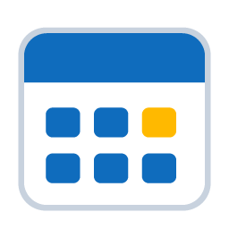
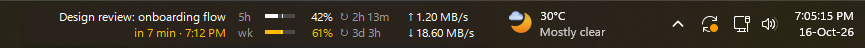
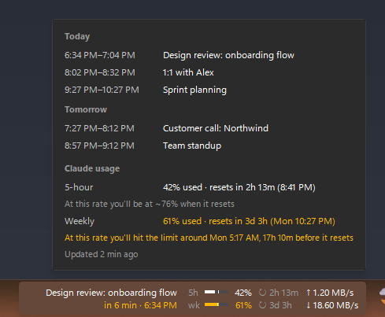
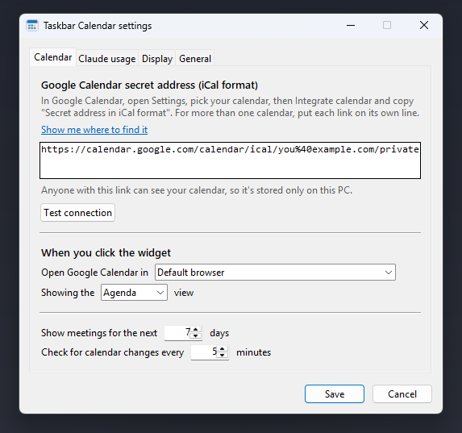
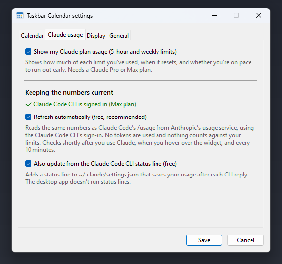

# Taskbar Calendar

**Your next meeting, your Claude plan usage and your network speed, right on the Windows 11 taskbar.**



Windows 11 removed the ability to add things to the taskbar. Taskbar Calendar brings a small, native-looking widget back. It sits next to the system tray, matches the taskbar's colors, and stays out of the way.

- **Next meeting** from Google Calendar, with a live countdown. The time turns amber when the meeting starts within 10 minutes and green while it's in progress. Click to open Google Calendar in the Chrome profile you choose.
- **Claude usage** for your 5-hour and weekly limits. Each row shows how much you've used, a small bar with a tick marking how much of the window has passed, and a countdown to the reset (↻). It turns amber when you're on pace to run out before the reset.
- **Network speed**, upload and download, across your physical network adapters.

Hover over the widget for the details:



## Install

You need **Windows 11** and **[Python 3.10 or newer](https://www.python.org/downloads/)**. When installing Python, tick *Add python.exe to PATH*.

1. Download this repository: **Code → Download ZIP**, then extract it somewhere permanent, such as `Documents\Taskbar-Calendar`. Or clone it:
   ```bash
   git clone https://github.com/farhanulju/Taskbar-Calendar.git
   ```
2. Right-click `install.ps1` → **Run with PowerShell**, or run:
   ```bash
   powershell -ExecutionPolicy Bypass -File install.ps1
   ```

The installer creates a private Python environment inside the folder, adds **Taskbar Calendar** to the Start menu and to startup, and launches it. The first time, the settings window opens so you can paste your calendar link.

## Settings

Everything is configured in a regular Windows settings window. To open it, right-click the widget → **Settings…**, or open **Taskbar Calendar** from the Start menu while it's running.

 

### Connecting Google Calendar

The widget reads your calendar through its **secret iCal address**, which is a private, read-only link. It needs no Google sign-in and no Google Cloud project.

1. Open [Google Calendar](https://calendar.google.com) → ⚙ **Settings**.
2. Under *Settings for my calendars*, pick your calendar → **Integrate calendar**.
3. Copy **Secret address in iCal format**, paste it into Taskbar Calendar's settings, and click **Test connection**.

For several calendars, paste one link per line. All-day events, cancelled events and meetings you've declined are skipped. If your workplace's Google admin has turned secret addresses off, the *Secret address* section won't appear.

### Claude usage

Requires a Claude **Pro or Max** plan and the [Claude Code CLI](https://code.claude.com/docs/en/setup), signed in with the same account.

The numbers can come from two places, and you can use either or both:

| Source | When it updates | Cost |
|---|---|---|
| **Automatic refresh** (recommended, and the only option for the Claude desktop app) | About a minute after you use Claude Code in the desktop app or the CLI. At most every 5 minutes, and never while you're idle. | One minimal Haiku request through the CLI: no tools, no MCP servers, nothing saved. About 900 tokens. |
| **CLI status line** | After every Claude Code CLI reply | Free. Claude Code passes the numbers to its [status line](https://code.claude.com/docs/en/statusline). |

The widget never reads your Claude login. Usage from claude.ai chats shows up at the next refresh. Hovering the widget also refreshes numbers older than 15 minutes.

## Using it

| Action | What happens |
|---|---|
| **Click** | Opens Google Calendar (agenda, day, week or month view) |
| **Hover** | Shows today's and upcoming meetings, plus Claude usage with reset times and a projection ("At this rate you'll be at ~76% when it resets") |
| **Right-click** | Join the video call (Google Meet, Zoom or Teams link found in the event), open the calendar, refresh, open Settings, or quit |

The widget hides itself when a full-screen app or video is in front, follows taskbar changes, and works with left-aligned taskbars by moving left of the weather widget.

## How it works

- **A window over the taskbar.** Windows 11 has no API for taskbar add-ons, so the widget is a borderless, always-on-top window placed in empty taskbar space. It copies the taskbar's color and has no taskbar button of its own.
- **Event-driven, not polling.** It reacts to Windows notifications instead of checking repeatedly: the taskbar being activated, full-screen apps opening (via the AppBar API), taskbar layout changes, display or theme changes, sleep and resume, and file changes. Countdowns update once a minute, on the minute. The only thing read every second is the network counters, because Windows has no notification for traffic, and only while the widget is visible. Typical CPU use is a fraction of a percent of one core.
- **Weather widget aware.** With left-aligned taskbar icons, Windows puts the weather widget next to the tray. The widget finds it through UI Automation and stays clear of it.
- **Network speed** comes from `GetIfEntry2` on physical adapters only, so VPN and virtual adapters don't double-count traffic.

## Privacy

- Your calendar link is stored only on your PC, in `%APPDATA%\TaskbarCalendar\config.json`. Anyone with that link can read your calendar, so don't share that file.
- The calendar is fetched directly from Google, and nothing is sent anywhere else.
- Claude usage is read through the official Claude Code CLI. Taskbar Calendar never touches your Claude credentials.
- Logs are kept in `%LOCALAPPDATA%\TaskbarCalendar\`, limited to about 2 MB.

## Troubleshooting

| Problem | Fix |
|---|---|
| "Set up your calendar" | Right-click → Settings and paste your secret iCal address |
| "Calendar unavailable" / ⚠ | Check your internet connection, and click **Test connection** in Settings. The link may have been reset in Google Calendar. |
| Claude shows "–" | Install the Claude Code CLI and sign in, then use Claude once. Requires a Pro or Max plan. |
| The widget overlaps something | Settings → Display → increase *Space to the right of the widget* |
| It doesn't start with Windows | Settings → General → *Start Taskbar Calendar when I sign in* |
| Anything else | Settings → General → **Open log folder** and check `taskbar_calendar.log` |

## Uninstall

```bash
powershell -ExecutionPolicy Bypass -File uninstall.ps1
```

This removes the shortcuts and the Claude Code status line, if Taskbar Calendar added one. Add `-DeleteSettings` to also delete your settings. Then delete the folder.

## Development

```bash
.venv\Scripts\python -m unittest discover -s tests -t .
```

- `TaskbarCalendar.pyw`: launcher. `pythonw` runs it without a console window.
- `taskbar_calendar/`: the app, with `widget.py` (UI), `settings_dialog.py`, `calendar_feed.py`, `claude_usage.py`, `netmeter.py`, `winapi.py` (Win32 and shell events), `config.py`, `chrome.py` and `shortcuts.py`.
- `python TaskbarCalendar.pyw --demo` shows made-up data. `tools/screenshots.py` regenerates the images in `docs/`, and `tools/make_icon.py` draws the icon.

Issues and pull requests are welcome.

## License

[MIT](LICENSE)
